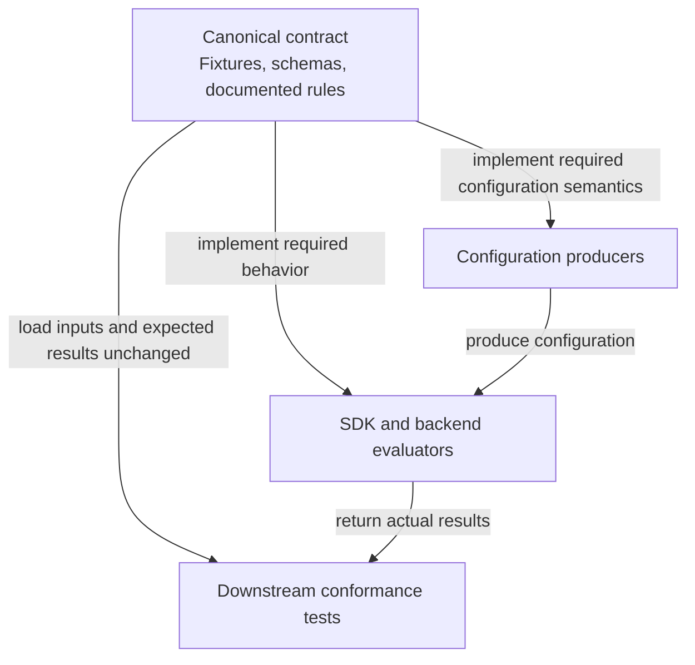

# ffe-system-test-data

The canonical behavioral contract for Datadog's Feature Flags & Experimentation
(FFE) implementations, expressed as shared test inputs and expected results.

## Overview

A fixture describes what an implementation must do with a particular
configuration, evaluation context, and set of options. The expected result can
include a value, reason, error code, selected allocation metadata, or emitted
events. The fixtures and their documented rules define the shared behavior
covered here; downstream projects implement that behavior in their own language.

## Contract ownership

**Downstream implementations must conform to this contract.** A language's
standard library, an existing SDK behavior, or the current backend deployment
does not redefine an expected result. For example, if a timestamp boundary test
distinguishes microseconds, the consumer must preserve that precision even when
its usual date type only stores milliseconds.



Configuration producers must emit the required fields with their defined
meaning. Evaluators implement parsing and evaluation. A downstream test adapter
maps the shared inputs and results to native APIs and checks the implementation
against the fixture. Rules-based tests can load `ufc-config.json` directly;
they do not need a running configuration compiler or deployed backend.

The contract can be extended or corrected through review in this repository.
An implementation mismatch is evidence to investigate, not an automatic reason
to change an expectation. See [handling a mismatch](#handling-a-mismatch).

Contract changes can land before every consumer implements them. SDK release
readiness, backend rollout order, and supported product versions belong in the
downstream projects' changes and release plans. This README describes stable
behavior and does not need an update whenever a consumer ships support.

## Start here

| What you are implementing | Contract to read | Test integration |
| --- | --- | --- |
| An SDK or backend that evaluates UFC rules | [`ufc-config.json`](ufc-config.json), [`evaluation-cases/`](evaluation-cases/), and [optional capabilities](#optional-capabilities) | Load the configuration through the real ingestion path and evaluate each case with the native evaluator. |
| An SDK that consumes precomputed assignments | [Precomputed fixture guide](precomputed-assignments/README.md) and [schema](schemas/precomputed-assignment.schema.json) | Supply the mocked response, run the ordered evaluations, and check results and emitted events. |

These families have different formats and runners. Passing one does not
establish coverage of the other. When changing the contract, also read
[CONTRIBUTING.md](CONTRIBUTING.md).

## Consumers

Downstream projects include:

- [system-tests](https://github.com/DataDog/system-tests) - Parametric tests
- [dd-trace-py](https://github.com/DataDog/dd-trace-py) - Python tracer
- [dd-trace-java](https://github.com/DataDog/dd-trace-java) - Java tracer
- [dd-trace-dotnet](https://github.com/DataDog/dd-trace-dotnet) - .NET tracer
- [dd-trace-go](https://github.com/DataDog/dd-trace-go) - Go tracer
- [dd-trace-js](https://github.com/DataDog/dd-trace-js) - JavaScript tracer
- [dd-trace-rb](https://github.com/DataDog/dd-trace-rb) - Ruby tracer
- [dd-trace-php](https://github.com/DataDog/dd-trace-php) - PHP tracer
- [libdatadog](https://github.com/DataDog/libdatadog) - Shared Rust FFE evaluator
- [openfeature-js-client](https://github.com/DataDog/openfeature-js-client) - Datadog OpenFeature JavaScript clients

## Directory Structure

```
ffe-system-test-data/
├── ufc-config.json          # Shared rules-based configuration, including malformed test inputs
├── evaluation-cases/
│   └── test-*.json          # Evaluation test case files
├── precomputed-assignments/
│   ├── README.md            # Precomputed assignment fixture format
│   └── cases/               # Precomputed assignment fixtures, discovered recursively
├── schemas/                # Precomputed assignment fixture schema
└── ci/                     # Static validators and downstream comparison runner
```

## Usage

### Pin the fixture revision

Add this repository as a submodule to your project:

```bash
git submodule add https://github.com/DataDog/ffe-system-test-data path/to/ffe-data
```

Initialize and update submodules when cloning:

```bash
git clone --recurse-submodules <your-repo>
# or after cloning:
git submodule update --init --recursive
```

Commit the submodule pointer in the downstream repository so local runs and CI
use the same fixture commit. During development, a consumer can pin a fixture PR
commit; update to the merged fixture revision before landing the consumer change.
If a repository uses a generated snapshot instead, retain the source repository
and exact commit SHA and refresh it from that source. Do not hand-edit expected
results in a downstream copy.

### Implement the rules-based runner

1. Load `ufc-config.json` through the consumer's real configuration parser and
   initialize its evaluator. Preserve the malformed inputs used by isolation tests.
2. Discover every `evaluation-cases/*.json` file and parse its array. Keep case
   order within each file, including repeated evaluations. Fail if the fixture
   directory is missing or empty.
3. Run every baseline case with default provider options, using `flag`,
   `variationType`, `defaultValue`, `targetingKey`, and `attributes` as supplied.
   Assert the expected value and reason, and any specified error code. Consumers
   exposing selected metadata must also check the supplied `serialId` and `doLog`
   expectations against the actual selection.
4. For each capability the consumer implements, map its name to the native
   option and rerun every case carrying that capability. Assert its expected
   result instead of the baseline result. Run capabilities separately.
5. Report the fixture SHA and executed case counts, including counts per
   supported capability. Fail if a supported capability discovers no cases.
   Skipping every capability case must not look like successful capability support.

The adapter may translate API names and native result containers. It must
preserve the meaning and precision of the inputs and expected results, including
`false`, `0`, empty values, and the distinction between absent and null fields.
Use SDK-local tests for behavior outside these fixtures, such as concurrency,
transport failures, and provider lifecycle.

## File Formats

### UFC Config (`ufc-config.json`)

The UFC (Universal Flag Configuration) file contains a document envelope and a
`flags` map. This is a complete minimal example of the rules-based format:

```json
{
  "createdAt": "2026-01-01T00:00:00Z",
  "format": "SERVER",
  "environment": { "name": "test" },
  "flags": {
    "flag-key": {
      "key": "flag-key",
      "enabled": true,
      "variationType": "BOOLEAN",
      "variations": { "on": { "key": "on", "value": true } },
      "allocations": [
        {
          "key": "ordinary",
          "rules": [],
          "splits": [{ "variationKey": "on", "shards": [] }],
          "doLog": false
        }
      ]
    }
  }
}
```

Valid allocations require an explicit boolean `doLog`. `false` is a valid
logging decision; omission and `null` are not valid substitutes. This input
requirement is separate from the optional `result.doLog` test expectation below.
Some fixtures deliberately contain malformed configuration to test error
handling; their presence does not make that input valid producer output.

### Evaluation Test Cases (`evaluation-cases/test-*.json`)

Each evaluation case uses a universal schema with the following fields:

| Field | Type | Description |
|-------|------|-------------|
| `flag` | string | The flag key to evaluate |
| `variationType` | string | Expected type: `BOOLEAN`, `STRING`, `INTEGER`, `NUMERIC`, `JSON` |
| `defaultValue` | any | The default value passed to the evaluation call |
| `targetingKey` | string or null | The subject/user identifier for evaluation. Use `null` only for explicit missing-targeting-key coverage |
| `attributes` | object | Additional context attributes for targeting rules |
| `result.value` | any | The expected evaluation result value |
| `result.reason` | string | The expected OpenFeature reason: `STATIC`, `SPLIT`, `TARGETING_MATCH`, `DEFAULT`, `ERROR`, `DISABLED` |
| `result.errorCode` | string | Optional OpenFeature error code, such as `PARSE_ERROR` or `FLAG_NOT_FOUND` |
| `result.serialId` | integer or null | Optional expected selected split serial ID. `0` is valid; `null` requires no serial ID; omission leaves it unspecified |
| `result.doLog` | boolean | Optional expected selected allocation's logging decision |
| `capabilities` | object | Optional expected results when a named capability is enabled; uses the same result format |

Example:

```json
[
  {
    "flag": "flag-key",
    "variationType": "BOOLEAN",
    "defaultValue": false,
    "targetingKey": "user-123",
    "attributes": {},
    "result": { "value": true, "reason": "STATIC" }
  }
]
```

### Optional capabilities

Every case still runs with default provider options and checks `result`.
For each supported entry in `capabilities`, enable that capability and repeat the
same evaluation. Check its expected result instead. Ignore unsupported entries,
not the baseline case. Capabilities run separately, not in combination.

A capability is a named optional behavior, not a release-status flag or a way
to exempt an implemented feature from conformance. A consumer that implements
the feature must wire its capability into the runner; updating the fixture pin
alone only adds baseline coverage.

`experimentationOptOutImmediate` enables immediate experimentation opt-out. The
input stays in `attributes.dd_experimentation_opt_out_at`. For example:

```json
{
  "flag": "integer-flag",
  "variationType": "INTEGER",
  "defaultValue": 0,
  "targetingKey": "5",
  "attributes": { "dd_experimentation_opt_out_at": "2026-10-19T12:00:00Z" },
  "result": { "value": 1, "reason": "SPLIT" },
  "capabilities": {
    "experimentationOptOutImmediate": { "value": 0, "reason": "DEFAULT" }
  }
}
```

The cases reuse `ufc-config.json`. Immediate mode skips allocations whose
`doLog` is true, then continues ordinary allocations. A valid
RFC3339 timestamp excludes immediately, including a future timestamp. A missing
attribute leaves evaluation unchanged. An invalid value returns the caller
default with `ERROR` / `INVALID_CONTEXT`. Default mode ignores the attribute.

Use the existing allocation `startAt`/`endAt` timestamp format and parsing
behavior. Do not introduce stricter timestamp syntax for opt-out alone.

Validation applies before allocation selection, including to ordinary flags with
`doLog=false`. Invalid input must not select an experiment or an ordinary fallback.
Do not coerce booleans, numbers, null, arrays, or objects into a timestamp or preference.
SDK diagnostics must identify the attribute and required format without echoing its value.
The caller must supply a valid timestamp to opt out, or omit the attribute to permit experimentation.

Existing readers can ignore the additional field and continue testing default
behavior. A supporting SDK adds the capability mapping to its existing reader;
updating the submodule alone does not test the enabled behavior. SDK tests retain
responsibility for telemetry, cache state, and provider lifecycle.

#### Future experiments only

`experimentationOptOutFutureExperimentsOnly` uses the same subject timestamp.
Map it to the provider's future-experiments-only mode, or
`DD_FEATURE_FLAGS_EXPERIMENTATION_OPT_OUT_MODE=future_experiments_only`.

| Allocation | With a valid subject cutoff |
| --- | --- |
| `doLog=false` | Evaluate normally. |
| `doLog=true`, activation before cutoff | Evaluate normally, including normal exposures. |
| `doLog=true`, activation at or after cutoff | Skip before targeting and sharding. Continue later allocations. |
| `doLog=true`, missing or null activation | Skip. Unknown activation does not establish an older experiment. |

The allocation field is `randomizationActivatedAt`, an optional RFC3339 timestamp.
Compare instants and preserve the fractional precision exercised by the cases;
rounding or truncating to milliseconds changes the required result. Choose a
native representation that retains the required precision. Do not use `startAt`,
`endAt`, the configuration's `createdAt`, or the SDK's clock as a substitute.
Existing schedule checks still apply to eligible allocations. No subject history
or SDK persistence is required.

The cutoff concerns allocation activation, not subject enrollment. An older
experiment can still assign a subject for the first time. Holdout allocations
use the same rule; the compiler supplies their activation metadata.

An absent subject timestamp preserves normal evaluation. Invalid subject input
returns `ERROR` / `INVALID_CONTEXT` before allocation selection, as in immediate mode.
A future cutoff is used directly; it does not schedule a future preference change.
Removing the attribute permits experimentation again.

The future-mode cases reuse existing flags. Added activation fields do not change
baseline or immediate results. Malformed activation parsing, configuration refresh,
exposure deduplication, and telemetry independence also need SDK-local tests.

### Selected split and allocation metadata

`test-case-serial-id-metadata.json` and `test-case-span-enrichment-inputs.json`
extract the reusable flag definitions and evaluation inputs from
[`system-tests` at `f2cbbc901577b80b8b6e7bf8757a46e0b8a10ce5`](https://github.com/DataDog/system-tests/tree/f2cbbc901577b80b8b6e7bf8757a46e0b8a10ce5/tests/parametric/test_ffe).
The nine flag definitions in `ufc-config.json` preserve the original configs'
serial IDs, targeting rules, variations, and `doLog` values.

Readers that expose selected split/allocation metadata should assert
`result.serialId` and `result.doLog` when present. Preserve the distinction
between a missing expectation, an explicit `null`, and the valid ID `0`.
The VIP and standard contexts select different allocations and serial IDs;
the repeated evaluations in the serial-ID file must run in order against the
same initialized evaluator. These expectations describe the UFC selection and
can be mapped to a native result or an SDK's evaluation-details metadata.

Existing readers can continue checking value, reason, and error code. They need
explicit metadata assertions to gain coverage for dropped zero IDs, fabricated
missing IDs, selecting the wrong split's ID, or losing the `doLog=false` decision.
The shared span-enrichment inputs provide IDs `100`, `108`, `128`, and `130` for
combined encoding and ID `200` with logging disabled. Downstream integration tests
retain trace construction, root-span propagation, subject hashing, encoding, and
capacity-limit assertions.

### SDK-Specific Fields

The shared fixtures use universal result fields rather than SDK-specific
containers such as `variant` and `flagMetadata`. Adapters should read the native
evaluation result and map it to these fields. For additional SDK-local assertions:

- **variant**: Use the selected variation key. Equal result values do not
  necessarily identify the same variation.
- **flagMetadata**: Map the selected split's `serialId` and allocation's `doLog` to
  the SDK's metadata keys; assert the optional expected fields above directly

### Precomputed Assignment Fixtures (`precomputed-assignments/cases/*.json`)

Precomputed fixtures cover SDKs that consume Datadog's
`/precompute-assignments` API instead of evaluating UFC locally. Each case
contains the context, mocked precompute response, typed evaluations to run, and
expected exposure/flagevaluation emission counts.

| Field | Type | Description |
|-------|------|-------------|
| `name` | string | Fixture identifier (matches filename stem) |
| `description` | string | Human-readable description of what the fixture covers |
| `context` | object | Evaluation context: `targetingKey` (string or null) and `attributes` (object) |
| `response` | object | Full precomputed-assignments JSON:API envelope served by the mock CDN |
| `_skip` | array? | Skip fixture for listed platforms: `[{"platform": "web", "reason": "..."}]` |
| `_include` | array? | Run fixture only for listed platforms |
| `evaluations` | array | Ordered list of typed flag evaluations to run |
| `evaluations[].flag` | string | Flag key to evaluate |
| `evaluations[].variationType` | string | `boolean`, `string`, `integer`, `float`, or `object` |
| `evaluations[].defaultValue` | any | Default value passed to the OpenFeature client |
| `evaluations[].expectedResult` | object | Expected outcome (`value`, `reason`, `errorCode`, `variantKey`) |
| `evaluations[]._skip` | array? | Skip this evaluation for listed platforms |
| `expectations.noUnmatchedEvents` | bool? | Assert all received events are consumed by matchers |
| `expectations.exposures` | array? | Ordered, exclusive matchers for exposure events |
| `expectations.evaluationEvents` | array? | Ordered, exclusive matchers for evaluation events |

See [precomputed-assignments/README.md](precomputed-assignments/README.md) for further detail.

## Automated Validation

Pull requests run a blocking static validation check over `ufc-config.json`
and every file in `evaluation-cases/`. It rejects invalid JSON, duplicate
object keys, malformed evaluation-case envelopes, mismatched flag or variation
map keys, and references to unknown flags without a `FLAG_NOT_FOUND`
expectation. Capability expectations may instead use `INVALID_CONTEXT` when
context validation precedes flag lookup. The baseline still requires `FLAG_NOT_FOUND`.

The validator deliberately does not fully schema-check allocation internals.
Some fixtures contain malformed flag fields on purpose to verify that consumers
reject only the affected flag.

Consumers exclude malformed flags from the active evaluation map while retaining
their rejected keys for the current configuration. Evaluating a rejected key
returns the caller default with `ERROR` / `PARSE_ERROR`; a key absent from both
maps returns `ERROR` / `FLAG_NOT_FOUND`. Each configuration refresh replaces both
maps atomically so fixed or deleted flags do not leave stale rejection entries.

```bash
python3 ci/validate-fixtures.py
python3 -m unittest discover -s ci -p 'test_*.py'
```

For precomputed fixtures, install `jsonschema` and run
`python3 ci/validate-precomputed-fixtures.py`. See the
[precomputed fixture guide](precomputed-assignments/README.md#schema-and-validation).
Static validation checks fixture structure; it does not execute an SDK or prove
the expected behavior is correct.

The [downstream compatibility workflow](.github/workflows/downstream-compatibility.yml)
runs native consumer tests against the base and proposed fixture revisions.
Its results are advisory evidence for review, even when a new mismatch makes
the comparison job fail. Inspect the tested consumer revision, runner, and
capability coverage; a passing baseline run does not prove a new capability was
executed. Local or CI conformance also does not prove deployment readiness.

## Handling a mismatch

1. Record the fixture commit, consumer commit, case file and index, enabled
   capability, expected result, and actual result. Run through the real parser
   and evaluator to distinguish an adapter bug from an implementation bug.
2. Check the documented rule and reproduce the relevant boundary. Once the
   expectation is confirmed, fix the downstream implementation to meet it.
   Keep any temporary downstream exclusion explicit and tracked; it does not
   change the shared expectation or establish conformance.
3. If the fixture is wrong or the intended behavior needs to change, propose
   that correction here with a concrete example, rationale, and consumer impact.
   Obtain contract review before propagating changed expectations downstream.

For example, a consumer treating `.123001` seconds as equal to `.123` has lost
precision required by the opt-out boundary cases. Fix its timestamp handling;
do not round the fixture to make that implementation pass. Likewise, backend
support that has not shipped yet is a rollout dependency, not a defect in a
fixture defining the intended behavior.

## Evaluation Cases

| File | Description |
|------|-------------|
| `test-case-boolean-false-assignment.json` | Boolean flag with false assignment via targeting |
| `test-case-boolean-one-of-matches.json` | Boolean flag with ONE_OF operator matching |
| `test-case-comparator-operator-flag.json` | Flag using comparator operators (GT, LT, etc.) |
| `test-case-disabled-flag.json` | Disabled flag returning DISABLED reason |
| `test-case-empty-flag.json` | Flag with empty configuration |
| `test-case-empty-string-variation.json` | Flag returning empty string as value |
| `test-case-experimentation-opt-out.json` | Baseline, immediate, and future opt-out behavior, including invalid subject input and ordinary fallbacks |
| `test-case-experimentation-opt-out-future.json` | Activation cutoffs, fractional precision, timezone offsets, and unknown activation |
| `test-case-experimentation-opt-out-do-log.json` | Ordinary allocations remain eligible when activation equals or follows the cutoff |
| `test-case-falsy-value-assignments.json` | Flags returning falsy values (0, false, empty) |
| `test-case-flag-with-empty-string.json` | Flag with empty string in configuration |
| `test-case-integer-flag.json` | Integer-typed flag evaluation |
| `test-case-kill-switch-flag.json` | Kill switch (emergency off) flag |
| `test-case-invalid-condition-operands.json` | Flags with invalid configured operands for GT, ONE_OF, and IS_NULL are removed without poisoning valid flags |
| `test-case-invalid-shard-bounds-isolation.json` | Flags with shard bounds outside Rust/schema integer ranges are removed without poisoning valid flags |
| `test-case-invalid-regex-isolation.json` | A flag with an invalid regular expression is removed without poisoning the configuration |
| `test-case-malformed-flag-isolation.json` | A structurally malformed flag is removed without poisoning valid flags |
| `test-case-variant-type-mismatch.json` | A flag whose variant violates its declared type is removed without poisoning valid neighboring flags |
| `test-case-microsecond-date-flag.json` | Flag with microsecond-precision date targeting |
| `test-case-missing-split-shards-isolation.json` | A flag with a split missing required `shards` is removed without poisoning valid flags |
| `test-case-new-user-onboarding-flag.json` | Multi-allocation onboarding flag with sharding |
| `test-case-no-allocations-flag.json` | Flag with no allocations (returns default) |
| `test-case-null-operator-flag.json` | Flag using IS_NULL operator |
| `test-case-null-shard-range-isolation.json` | A flag with a null shard range is removed without poisoning valid flags |
| `test-case-null-targeting-key.json` | Evaluations with an explicit null targeting key |
| `test-case-numeric-flag.json` | Numeric flag evaluation |
| `test-case-numeric-one-of.json` | Numeric ONE_OF operator matching |
| `test-case-of-7-empty-targeting-key.json` | Evaluation with empty targeting key |
| `test-case-numeric-one-of-default.json` | Numeric ONE_OF flag returning the default value when no rule matches |
| `test-case-regex-flag.json` | Flag using regex matching operator |
| `test-case-semver-comparison-flag.json` | Flag using semver comparison operators (SEMVER_EQ, SEMVER_NEQ, SEMVER_LT, SEMVER_LTE, SEMVER_GT, SEMVER_GTE), including prerelease ordering and invalid/missing attribute handling |
| `test-case-semver-precedence-flag.json` | SemVer precedence edge cases that are easy to get wrong: multi-digit numeric prerelease ordering (beta.2 < beta.11), build-metadata-ignored across every operator (EQ/NEQ/LT/LTE/GT/GTE), and alphanumeric prerelease ordering (alpha < alpha.1 < alpha.beta < beta < release) |
| `test-case-semver-version-parts.json` | Extended version-part support: one- and two-part versions normalize to three parts, and four- and five-part versions are accepted, covering both attributes and configured comparands |
| `test-case-semver-validation-flag.json` | SemVer 2 syntax boundaries retained by the extended parser, invalid syntax, non-string attributes, and invalid configured comparands |
| `test-case-semver-invalid-comparand-waterfall.json` | An invalid configured SemVer comparand in a non-last allocation of a waterfall must reject the whole flag at parse time rather than skipping it and falling through to a later valid default |
| `test-case-semver-invalid-comparand-categories.json` | Configured SemVer comparand boundaries: a valid hyphen-heavy prerelease matches, while invalid syntax (including consecutive dots and a Ruby-style `.DEV` suffix), v-prefixed, leading-zero, and non-string comparands reject their flag at parse time with PARSE_ERROR without poisoning the rest of the configuration |
| `test-case-serial-id-metadata.json` | Selected split IDs, including zero, absence, targeting, and repeated evaluations |
| `test-case-span-enrichment-inputs.json` | Selected IDs and logging decisions used by downstream span-enrichment tests |
| `test-case-start-and-end-date-flag.json` | Flag with start/end date time bounds |
| `test-case-unknown-fields-tolerance.json` | Unknown UFC object fields are ignored |
| `test-case-unknown-operator-isolation.json` | A flag with an unknown operator is removed without poisoning valid flags |
| `test-flag-that-does-not-exist.json` | Non-existent flag returning the default value with `FLAG_NOT_FOUND` |
| `test-json-config-flag.json` | JSON-typed flag returning object value |
| `test-no-allocations-flag.json` | Another no-allocations variant |
| `test-special-characters.json` | Flag keys/values with special characters |
| `test-string-with-special-characters.json` | String values with special characters |

## Origin

These fixtures originated in the Go SDK (`dd-trace-go`). This repository now
owns the shared contract; Go and every other downstream implementation consume
it and are subject to the same conformance requirements.

## Downstream Updates

Add shared evaluator behavior here, then update each consumer's
[pinned fixture revision](#pin-the-fixture-revision) and native test runner.
See [Updating Downstream Repositories](CONTRIBUTING.md#updating-downstream-repositories)
for the integration checklist.

### Informational Compatibility Preview

Fixture pull requests also run the canonical evaluation suite from Go, Java,
JavaScript, Python, Ruby, .NET, PHP, and `libdatadog` against both the
pull-request merge base and proposed head. Each job classifies the result as
compatible, a new regression, an improvement, or existing downstream drift and
uploads the two logs.

These compatibility jobs are intentionally advisory and are allowed to fail.
They must not be configured as required merge checks. Their purpose is to show
contributors where to start investigating; a mismatch can indicate either a
downstream implementation gap or an incorrect expectation in this repository.
The preview does not automatically update submodule pins, open issues, or
decide which side is wrong.

The executable entrypoints currently live on purpose-built consumer branches
based on each repository's default branch. This repository only orchestrates
those consumer-owned tests.

## Contributing

See [CONTRIBUTING.md](CONTRIBUTING.md) for guidelines on adding or modifying test cases.

## License

Unless explicitly stated otherwise, all files in this repository are licensed under the Apache 2.0 License.

This product includes software developed at Datadog (https://www.datadoghq.com/). Copyright 2026 Datadog, Inc.

See [LICENSE](LICENSE) for the full license text.
