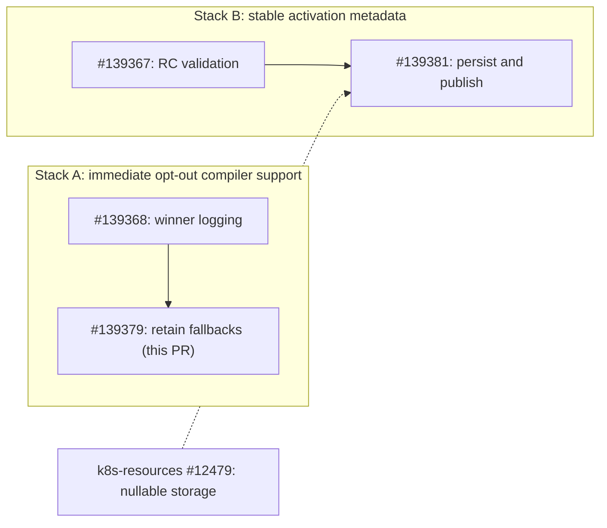
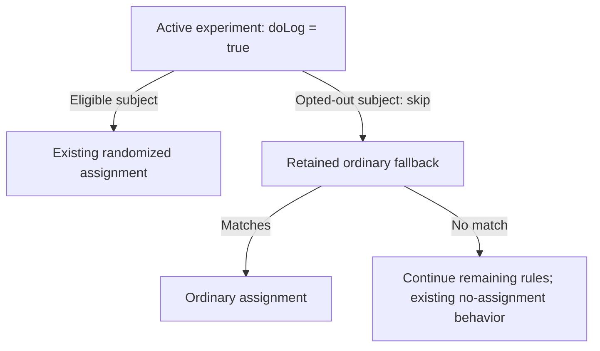

## Motivation and Context

Implements ordinary fallback delivery from [RFC: Classifying allocations for per-subject experimentation opt-out](https://docs.google.com/document/d/153tRlj46l-XfBGCA2X_NvxW4vwYObaH8zm2moP_AqMk/edit), **What exclusion means during evaluation**.

The agreed behavior skips experimental allocations before randomization and continues ordinary rules. The compiler currently removes those later rules after a full-population experiment.

### PR stack order

**Position:** Stack A, second PR. Solid arrows show Git parent → child. The dashed arrow shows a deployment prerequisite, not a Git parent.

| Stack goal | Review and merge order | Why stacked |
| --- | --- | --- |
| **A: preserve ordinary delivery during immediate opt-out.** | [#139368](https://github.com/ddoghq/dd-source/pull/139368) → [#139379](https://github.com/ddoghq/dd-source/pull/139379) | Correct winner classification first. The fallback optimizer then uses that classification to retain skippable experiments' fallbacks. |
| **B: provide stable activation times for future-experiments-only mode.** | [#139367](https://github.com/ddoghq/dd-source/pull/139367) → [#139381](https://github.com/ddoghq/dd-source/pull/139381) | Separate schema acceptance from emission, so validators can deploy before producers. |

Both stacks start from `main` and can progress independently. [Migration #12479](https://github.com/ddoghq/k8s-resources/pull/12479) targets `k8s-resources/master`. Deploy it and RC validation before #139381; merging alone is insufficient.

## Description

Retain later allocations and their variants until an ordinary full-population allocation makes them unreachable. Preserve evaluation reasons and assignments for subjects who remain eligible.

Completed deterministic winners still terminate the waterfall. Active experiments, including 100% enrollment and single-arm experiments, retain their fallback. This change adds no SDK configuration or telemetry.

For a full-population experiment, the compiled configuration must support both paths:

This PR preserves the rules. It does not add the evaluator's opt-out check.

Compatibility delivery follows authored SemVer targeting even when the optimizer removes the SemVer rule: only the existing safe tracer targets receive such flags. Overrides retain their exception. This applies independently of opt-out and preserves unrelated flags.

### Later stacks: preview

These are planned follow-up groups, not additional published PRs in this series.

| Order | Goal | Scope |
| --- | --- | --- |
| **C: complete activation coverage** | Establish usable activation metadata for supported allocation types. | Remaining lifecycle writers, canary/bandit coverage where supported, holdout timing, and missing-metadata behavior. |
| **D: shared fixtures and evaluators** | Apply the same cutoff rule locally and at the edge. | Timestamp fixtures first; Go/Rust evaluators, JSON/archive compatibility, Precompute transport, and cache handling. |
| **E: SDK delivery** | Let customers select future-experiments-only behavior consistently. | Extend existing opt-out integrations, pass the customer cutoff, and test request acknowledgement and cached-state compatibility. |

The existing immediate-mode SDK work does not wait for C–E. Future-mode enablement requires completed producer/consumer support and end-to-end validation; these five PRs do not enable it.

## How has this been tested?

With the current winner-classification parent integrated, local suites pass 947 compiler, 108 Remote Config, and 85 cache-worker test entries. The 24-case shared corpus covers authored SemVer, optimizer pruning, active experiments, overrides, and rollout on/off through the real compiler/filter and JSON/protobuf output. The old filter fails the two pruning cases. Existing fallback tests retain 12,288 eligible-subject comparisons.

Six new Lean theorems and the same 24 cases check the bounded delivery model; 59 total theorems, 313 existing semantic cases and 36 operational cases pass. This proves properties of the model, not native equivalence or deployed behavior. The parent rollout-control review and configuration rebuild/deployment gates remain separate.

## What is expected of reviewers?

Review the optimizer's reachability rule and evaluation-reason compatibility. Retained fallbacks increase configuration size when a logging allocation previously removed them.

<!-- ffe-review-routing:status:v1:start -->

## Reviewer selection

🤖 **Automatically generated · runs asynchronously.** The FFE reviewer-routing workflow maintains this section; it does not replace human review.

✅ **Complete — reviewer coverage verified.**

**What happened:** The workflow matched this PR to the published registry, selected 3 reviewers for its initiative and any additional review areas, and checked their pending requests or submitted reviews on the evaluated head. Existing reviewers and teams were preserved. Coverage is not approval.

### Decision

**Initiative:** project / ufc-compliance

**Why this match:** The change preserves ordinary fallback delivery when exposure-logging experiment allocations are skipped for experimentation/privacy opt-out, while keeping non-opted-in subject assignments and evaluation reasons compatible.

**Why these owners:** The matched initiative has fewer than two approved, non-author candidates. The approved global pool supplies the remaining review owners; proposed memberships were not activated.

**Additional review: infra** — The optimizer and reason assignment change shared UFC generation behavior by retaining fallbacks after logging allocations and pruning only after ordinary full-population allocations. Coverage: @tyler-potter\_ddog. Evidence: domains/ffe/libs/flagging/ufc/optimizer.go, domains/ffe/libs/flagging/ufc/compiler.go

- @sameeran-kunche_ddog — **final owner** (final-review-owners): Global review owner filling the remaining slot and responsible for obtaining review. Review requested.
- @greg-huels_ddog — **final owner** (final-review-owners): Global review owner filling the remaining slot and responsible for obtaining review. Review requested.
- @tyler-potter_ddog — **specialist** (infra): Specialist pod member covering an additional review area. Covers: infra. Review requested.

The PR author is excluded from reviewer selection.

### Debug or fix a problem

[Workflow run](https://app.datadoghq.com/workflow/514c43cc-c4b4-4eca-932a-f78f429a9898?instance=ca190be8-4b7a-44e9-acc2-f481b3387848) · [Bits Code session](https://app.datadoghq.com/code/f32aed40-bd1a-4a44-a206-7aa39e059ad0)

- **Wrong project or pod?** Clarify this PR’s purpose, or correct the [reviewer registry](https://docs.google.com/spreadsheets/d/1Okqxei67vgpsqjokABa_IU7edwh27Mu-RNz6jwnUE6U/edit) and [publish the change](https://github.com/ddoghq/claude-marketplace/blob/leo/ffe-review-pods/ffe-internal/skills/route-pr-reviewers/workflow/production/README.md#publish-the-sheet). Sheet edits take effect after publication.
- **Need another reviewer now?** Request them in GitHub. This workflow only adds requests and keeps existing reviewers.
- **Stuck beyond five minutes or failed?** Inspect the run’s failed step and available Bits session. After fixing the cause, rerun the workflow with this PR URL and `dry_run=false`. Unchanged completed runs are skipped. If the receipt says `needs_reconciliation` or a write outcome is uncertain, ask the workflow owner to reconcile GitHub and the receipt before retrying; do not delete the lock blindly.
- **Report a problem:** Comment on the [reviewer-routing skill PR](https://github.com/ddoghq/claude-marketplace/pull/5067) with this PR URL, the workflow run link, and the expected initiative or reviewer correction.

Evidence and run details

Changed paths: `domains/ffe/libs/flagging/ufc/optimizer.go`, `domains/ffe/libs/flagging/ufc/compiler.go`, `domains/ffe/libs/flagging/ufc/opt_out_fallback_test.go`

Evaluated head: `1a71c67a6f1de54e0ee9754bcf36da54100f553f`

Registry revision: `revision:54491247-28c5-4ac2-a03b-579fcf68b1c0`

Loaded skill: `3f59fe8e29584b48a3cf48382805c351f0e3d21b`

<!-- ffe-review-routing:status:v1:end -->
